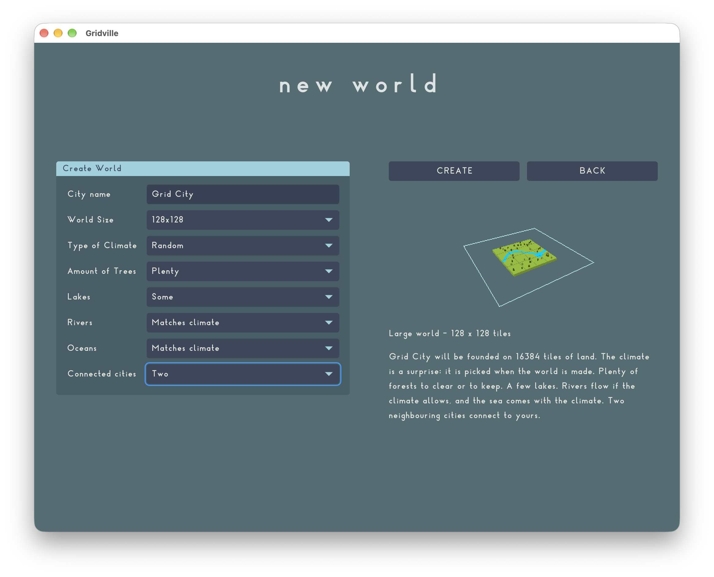

## New UI widgets

We have new UI widgets. [raygui](https://github.com/raysan5/raygui) was great for a quick start, but we reached a phase where it started to show some serious issues. The new system should make development faster.

Besides a bunch of new widgets, we now have a proper layout system, which should help with different screen sizes.

## A proper font

We also have a proper font now. We picked [Sauber Typeface](https://www.harismerzihic.com/sauber) by Haris Merzihic. This is how the author describes it: "A typeface inspired by and celebrating German Modernism and the 100 year anniversary of the Bauhaus art and design movement." We would be crazy not to pick that font for this game.

## Play in the browser

You can also try Gridville for yourself [from the browser](https://aerkalov.github.io/gridville/play/gridville.html). It is still far away from playable, but it should help you get a better understanding of where this game is going.
