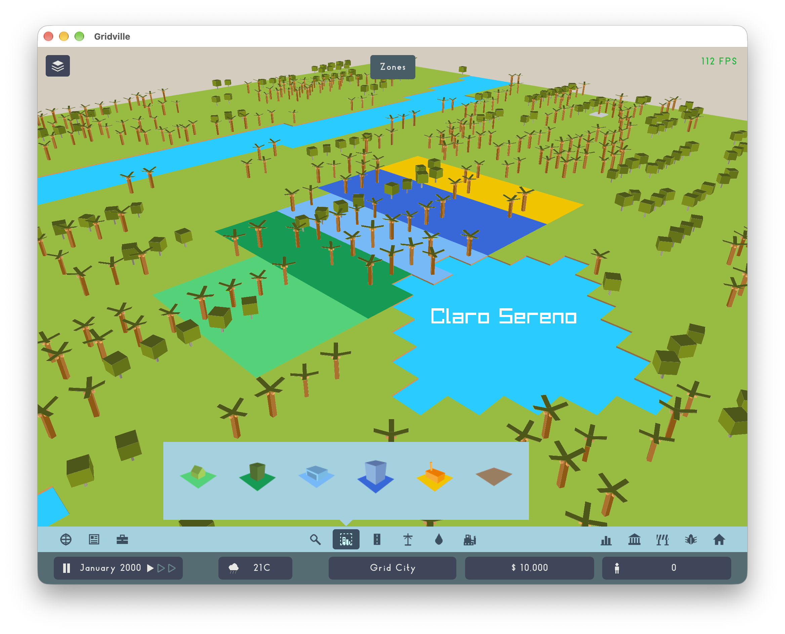
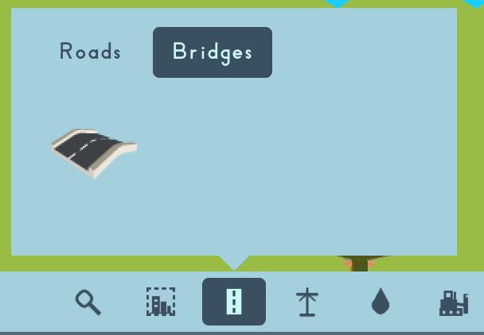
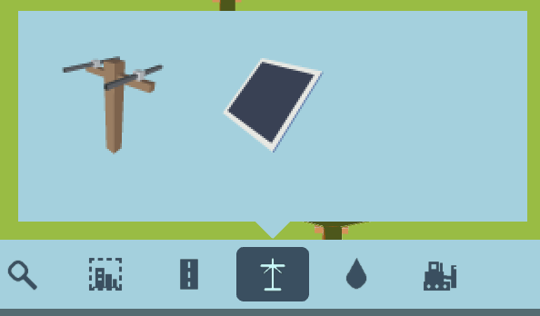
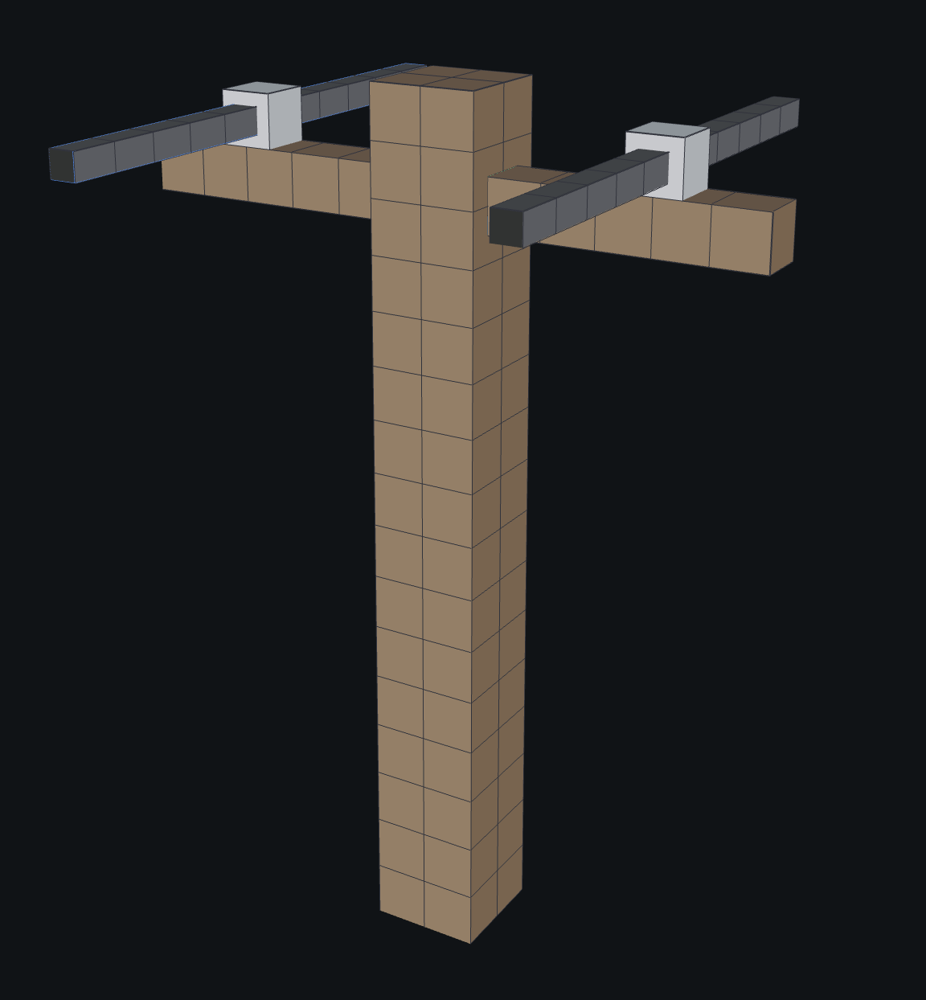

## Zones

Finally, zones are here. Nothing is happening in them yet, but you can create them, erase them, and they look nice! And yes, there will be more zones in the future.

## New icons

We have a bunch of new icons for the tools. They look much nicer (except for the pipe) and are more detailed.

## Blockbench

Instead of drawing some of the tools (bridge, roads, electric pole, ...), we are now modeling them in Blockbench. As you can see, it looks much nicer now.

